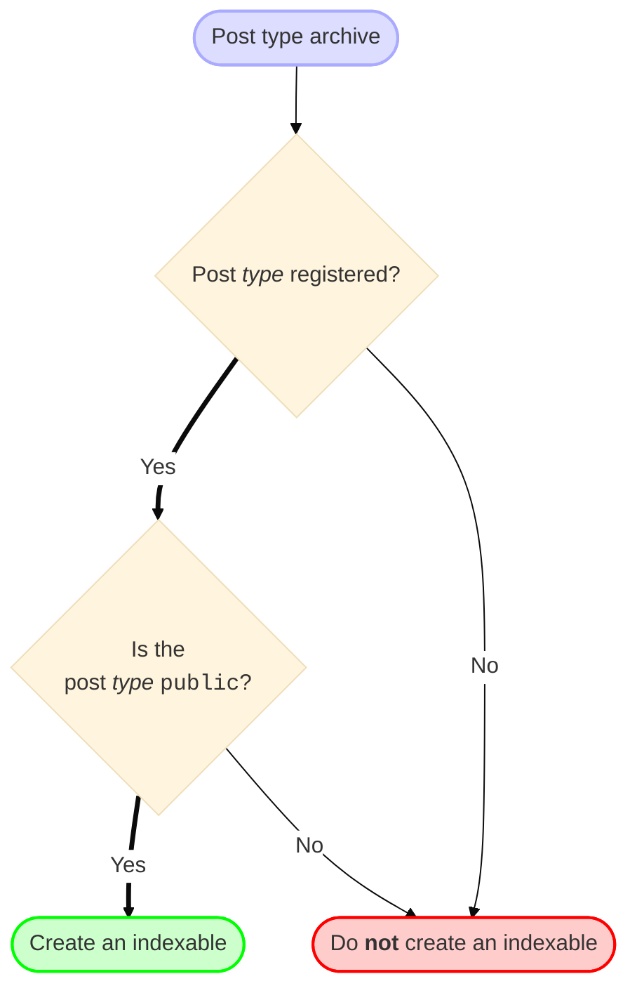
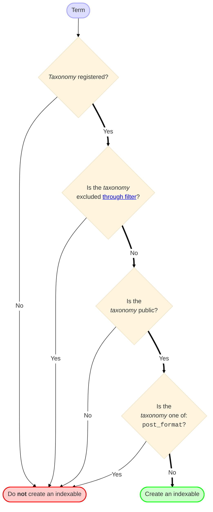
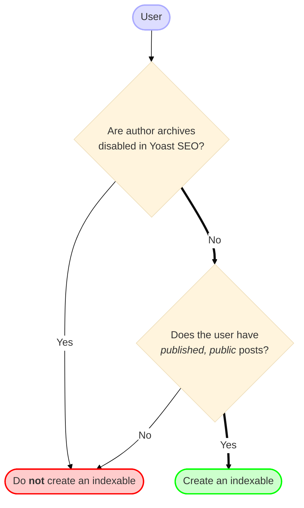

## 简介

我们为网站上的所有可索引对象创建了索引项。这些是搜索引擎能够访问的所有 URL。由于 WordPress 存储内容的方式，其中大部分将是“文章”（在 WordPress 数据模型中，页面也被视为“文章”）。因此，大多数网站上的索引项主要是文章。

我们为某些特殊内容创建了专门的索引项，以避免它们轻易地堵塞数据库。这尤其适用于日期归档页面和系统页面（搜索结果页、404 页面）。它们各自拥有一个索引项，用于存储我们的标题模板，以便在前端使用这些模板。

## Which "things" get an indexable?

### Posts

There are quite a few different types of using posts within WordPress. Only those that are publicly viewable should be
considered indexable objects. Of course a post has to _exist_ to be a valid Indexable object.

```mermaid
%%{init: {'theme': 'base', 'themeVariables': { 'edgeLabelBackground':'#ffffff', 'stroke':'#000'}}}%%
 flowchart TD
  Input([Post]) --> PTRegistered{Post <em>type</em> registered?}
  PTRegistered == Yes ==>PTExcluded{Post <em>type</em> excluded<br/><a href='/features/indexables/indexables-filters/#post_types'>through filter</a>?}
  PTRegistered -- No -->NoIndexable([Do <strong>not</strong> create an indexable])
  PTExcluded -- Yes -->PTIncluded{Post <em>type</em> force included<br/><a href='/features/indexables/indexables-filters/#included_post_types'>through filter</a>?}
  PTExcluded == No ==>PTPublic{Is the<br/>post <em>type</em> <code>public</code>?}
  PTPublic == Yes ==>PTAttachment{Is the post<br/><em>type</em> <code>attachment</code>?}
  PTPublic == No ==>PTIncluded
  PTAttachment -- Yes -->AttDisabled{Are <a href='https://yoast.com/features/redirect-attachment-urls/'>attachment URLs<br/> disabled</a> in Yoast SEO?}
  AttDisabled -- Yes -->PTIncluded
  AttDisabled == No ==>PSRegistered{Post <em>status</em> registered?}
  PTAttachment == No ==>PSRegistered
  PSRegistered -- No -->NoIndexable
  PSRegistered == Yes ==>PSPublic{Is the post<br/><em>status</em> <code>public</code>?}
  PSPublic -- No -->IncludedNonPublishPostStatus{Post <em>status</em> one of:<br/><code>draft</code>, <code>pending</code>, <code>future</code>?}
  PTIncluded == No -->NoIndexable
  PTIncluded == Yes -->CreateIndexable
  IncludedNonPublishPostStatus -- No -->NoIndexable
  IncludedNonPublishPostStatus == Yes ==>CreateIndexable
  PSPublic == Yes ==>CreateIndexable([Create an indexable])
  style Input fill:#ddf,stroke:#aaf,stroke-width:2px
  style NoIndexable fill:#ffcccc,stroke:#f00,stroke-width:2px
  style CreateIndexable fill:#ccffcc,stroke:#0f0,stroke-width:2px
```

### Post type archives

A post type archive will only have an indexable when the post type it's registered for is public.



### Terms

A term has to be part of a registered, public taxonomy to be an indexable object.



### Users

Only when a user has published posts that are public, do they get an author archive. At that point, they become an indexable object.

